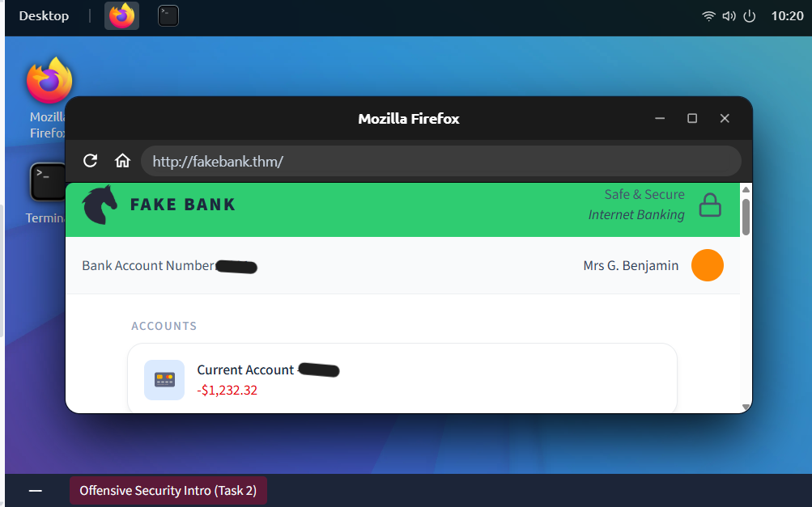
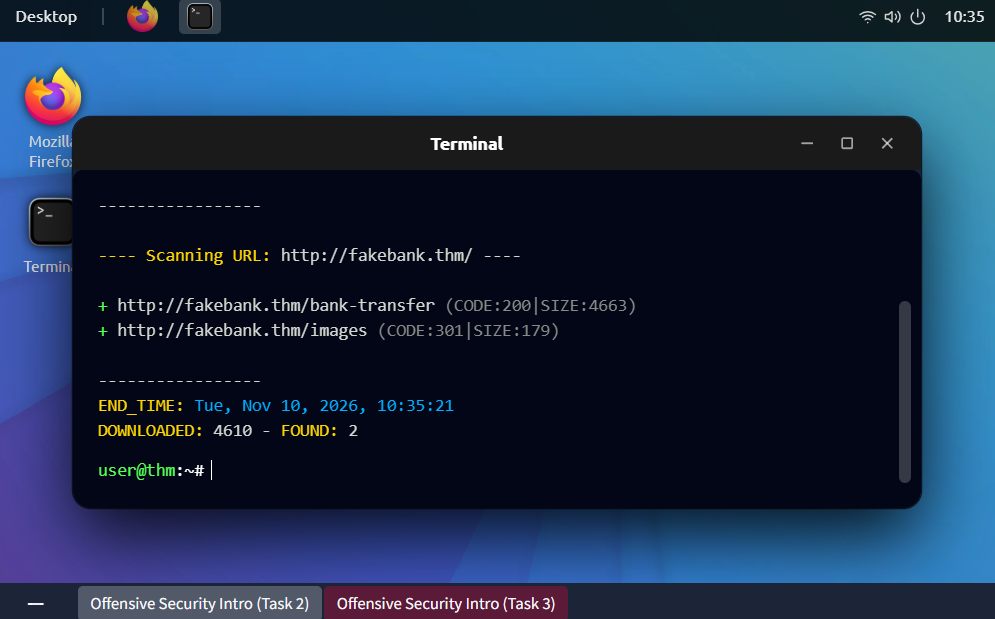
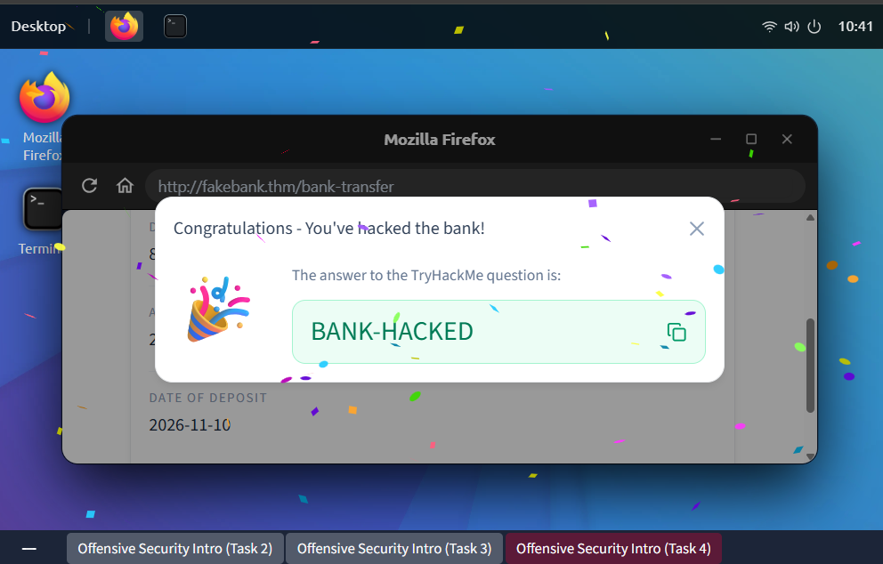

# offensive Security Introduction

**Platform:** TryHackMe | **Path:** Pre Security | **Status:** Completed

## What this room covers
This room introduces offensive security: thinking like an attacker to find weaknesses in a system before the hackers do. It puts you in a safe, legal lab where you attack a fake banking website, find a hidden page, and use it to do something the app never intended.

## Lab setup

The room provides a virtual desktop with a browser and a terminal. The target is **FakeBank**, a deliberately vulnerable banking app running at `fakebank.thm`. Because it's a purpose-built practice environment, it's legal to attack. In real life, testing a system without explicit permission is illegal, even if your intentions are good.

## Finding hidden pages

- **Tool used:** `dirb`
- **Command:** `dirb http://fakebank.thm`
- **What it does:** Directory enumeration. The tool tries thousands of common page and folder names against the website and reports which ones exist, including pages that aren't linked anywhere.
- **Reading the output:** Lines starting with `+` are pages that were found. `CODE:200` means the page exists and loaded. `CODE:301` means the request was redirected, which is typical for folders.
- **Result:** The scan found 2 paths, one of which was not meant to be public.

## Using what I found

I visited the hidden page from the scan in the browser. It gave me access to functionality that should only be available to authorised users, and I used it to change the account's balance. There was no login or permission check protecting it.

## Key takeaways
- **Hiding is not securing.** The developers assumed nobody would find the page because nothing linked to it. A tool like `dirb` finds it in seconds.
- **Every sensitive page needs authentication and authorisation checks**, no matter whether it's linked or not.
- **How a defender would prevent this:** require login and permission checks on every sensitive page, remove unused pages, and monitor for large numbers of requests to non-existent URLs, since that's what a scanning tool looks like in the logs.
- **Offensive and defensive security work together.** Attackers (or ethical hackers) find the flaws, and defenders fix and monitor them.

## What I'd like to learn next
- Defensive Security Intro
- Networking and Linux fundamentals
- Other enumeration tools and how they differ from `dirb`
